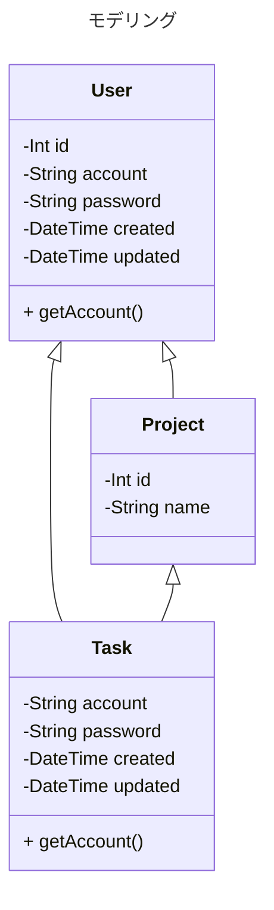

# 最初に
```bash
export WWWUSER=$(id -u)
export WWWGROUP=$(id -g)
```

# info cloneから開始する場合

```bash
$ git clone git@github.com:l-freeze/laravel10-clean-architecture.git
$ cd laravel10-clean-architecture
```

composer install
```bash
$ docker run --rm -v "$(pwd)":/opt -w /opt -u `id -u`:`id -g` \laravelsail/php82-composer:latest composer install
```

.env
```bash
#任意で変更
APP_PORT=8080

#書き換え
DB_HOST=mysql
DB_USERNAME=sail
DB_PASSWORD=password
#CACHE_DRIVER=file
CACHE_DRIVER=redis
#SESSION_DRIVER=file
SESSION_DRIVER=redis


#追加
SCOUT_DRIVER=meilisearch
MEILISEARCH_HOST=http://meilisearch:7700

SAIL_XDEBUG_MODE=develop,debug,coverage
APP_TIMEZONE=Asia/Tokyo
PHP_IDE_CONFIG="serverName=localhost"
COMPOSE_INTERACTIVE_NO_CLI=true
```

build
```bash
./vendor/bin/sail down --rmi all --volumes --remove-orphans
./vendor/bin/sail build --no-cache
./vendor/bin/sail up -d
```

# info 初期構築時のメモ

```bash
curl -s "https://laravel.build/laravel10-clean-architecture" | bash

cd laravel10-clean-architecture
./vendor/bin/sail artisan sail:publish
```

edit: ./docker/8.2/php.ini

```vim
+ [xdebug]
+ xdebug.start_with_request=yes
```

edit `.vscode`
```
.vscode参照
```

launch app
```bash
./vendor/bin/sail build --no-cache
./vendor/bin/sail up -d
```

connect to mysql
```bash
./vendor/bin/sail mysql
```

larastan
```bash
 ./vendor/bin/phpstan analyze --level=4 ./domain/ --memory-limit=1G
```


[register](http://localhost:8080/account/register?email=address@example.com&password=password?name)  
http://localhost:8080/api/account/register?email=address@example.com&password=password?name
http://localhost/api/account/register?email=address@example.com&password=password?name

[show](http://localhost:8080/account/show?email=address@example.com)  
http://localhost:8080/api/account/show?email=address@example.com


### vite
install
```bash
./vendor/bin/sail npm install 
```

run dev
```bash
./vendor/bin/sail npm run dev
```

run build
```bash
./vendor/bin/sail npm build
```


install solid
```bash
./vendor/bin/sail npm install solid-js
./vendor/bin/sail npm install -D typescript vite vite-plugin-solid
./vendor/bin/sail npm install -D vite-tsconfig-paths
./vendor/bin/sail npx tsc --init
```
要参照
- package.json
- tsconfg.json
- vite.cofig.js



