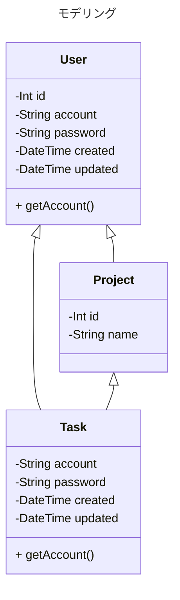

# info


```bash
curl -s "https://laravel.build/laravel10-clean-architecture" | bash

cd laravel10-clean-architecture
./vendor/bin/sail artisan sail:publish
```


edit: ./docker/8.2/php.ini

```vim
+ [xdebug]
+ xdebug.start_with_request=yes
```

edit `.vscode`
```
.vscode参照
```

launch app
```bash
./vebdir/bin/sail build --no-cache
./vebdir/bin/sail up -d
```

connect to mysql
```bash
./vendor/bin/sail mysql
```

larastan
```bash
 ./vendor/bin/phpstan analyze --level=4 ./domain/ --memory-limit=1G
```


[register](http://localhost:8080/account/register?email=address@example.com&password=password?name)  
http://localhost:8080/account/register?email=address@example.com&password=password?name

[show](http://localhost:8080/account/show?email=address@example.com)  
http://localhost:8080/account/show?email=address@example.com


### vite
install
```bash
./vender/bin/sail npm install 
```

run dev
```bash
./vender/bin/sail npm run dev
```

run build
```bash
./vender/bin/sail npm build
```


install solid
```bash
./vendor/bin/sail npm install solid-js
./vendor/bin/sail npm install -D typescript vite vite-plugin-solid
./vendor/bin/sail npm install -D vite-tsconfig-paths
./vendor/bin/sail npx tsc --init
```
要参照
- package.json
- tsconfg.json
- vite.cofig.js


